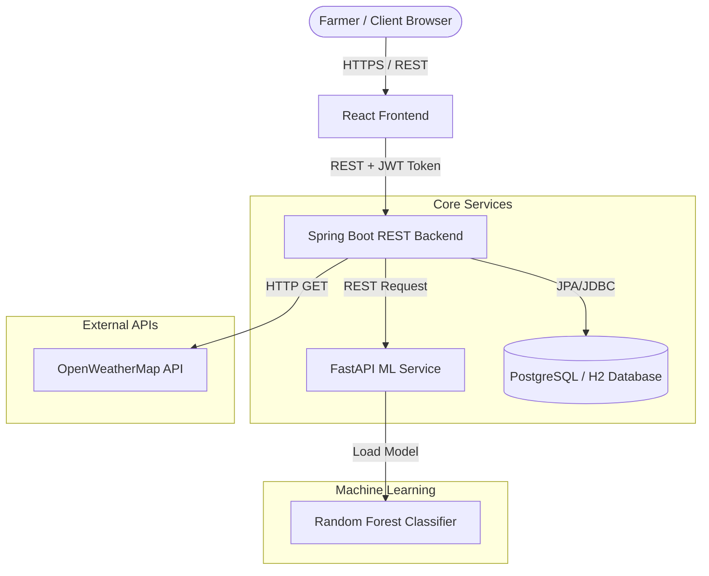
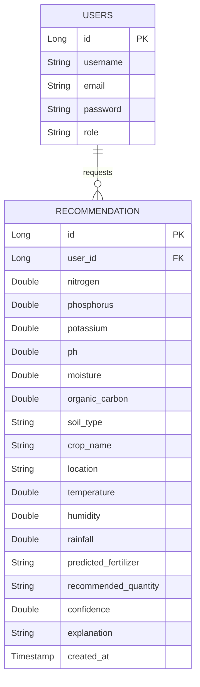

# System Architecture Documentation

This document describes the design, system components, and communication pathways of the **Smart Fertilizer Recommendation Engine**.

---

## 1. System Topology

The engine is built on a decoupled, three-tier architecture:

### Components
1. **React Frontend**: Handles forms, user profiles, interactive dashboard charts, reports, and responsive layouts.
2. **Spring Boot Backend**: Serves as the security firewall, handles database operations, user sessions, audit history, and manages calls to the weather API and ML service.
3. **FastAPI ML Service**: A lightweight Python service running a Random Forest Classifier trained on agronomical rules to perform high-speed fertilizer recommendations.
4. **Database**: H2 (used for local testing) and PostgreSQL (used for production).

---

## 2. API Endpoints Map

### Backend (Spring Boot) - Port `8080`
| HTTP Method | Route | Description | Auth Required |
|---|---|---|---|
| **POST** | `/api/auth/register` | Registers a new user account | Public |
| **POST** | `/api/auth/login` | Authenticates user & returns JWT token | Public |
| **POST** | `/api/recommendations/predict` | Computes & stores fertilizer recommendation | User/Admin |
| **GET** | `/api/recommendations/history` | Fetches historical recommendations for user | User/Admin |
| **GET** | `/api/dashboard/stats` | Fetches dashboard trends and summaries | User/Admin |

### ML Engine (FastAPI) - Port `8000`
| HTTP Method | Route | Description | Auth Required |
|---|---|---|---|
| **GET** | `/health` | Verifies ML model readiness and system health | Public |
| **POST** | `/predict` | Evaluates soil features & returns fertilizer prediction | Public |

---

## 3. Database Schema Entity Relationship

