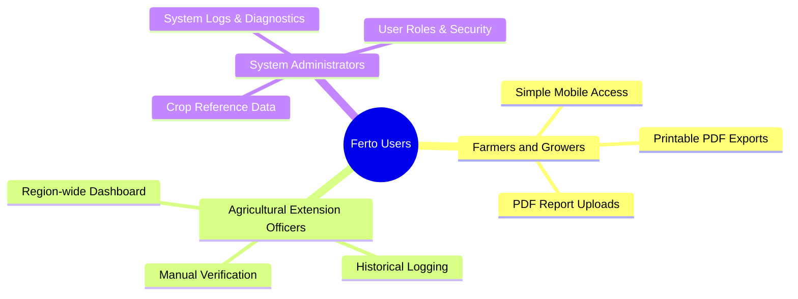

# Product Requirements Document (PRD)
## Ferto: Smart Fertilizer Recommendation Engine

| Document Detail | Value |
| --- | --- |
| **Product Name** | Ferto (Smart Fertilizer Recommendation Engine) |
| **Document Version** | v1.0.0 |
| **Status** | Draft (Pending Review) |
| **Target Release** | Q3 2026 |
| **Author** | Antigravity AI |
| **Last Updated** | 2026-07-09 |

---

## 1. Executive Summary & Objective

Modern agriculture faces the dual challenge of maximizing crop yield to feed a growing population while practicing sustainable land stewardship. Farmers often rely on generalized fertilizing practices, leading to soil degradation, chemical runoffs, increased costs, and poor crop yields. 

**Ferto** is an AI-powered agricultural web application designed to deliver highly customized fertilizer recommendations. By evaluating real-time soil nutrient composition, crop parameters, regional weather conditions, and environmental metrics, Ferto's Machine Learning model outputs targeted recommendations. Ferto empowers farmers to optimize their soil health, minimize fertilizer expenditures, and maximize harvest productivity.

### Key Objectives
* **Acknowledge Regional Context:** Incorporate live weather metrics (temperature, humidity, rainfall) and local geographic factors into nutrient recommendation formulas.
* **Bridge Technical Gaps:** Enable farmers to easily upload digital soil lab reports (PDF, Text, or Images) and extract values automatically via OCR/Regex.
* **Deliver Actionable Advice:** Provide not just a chemical name, but clear dosages (kg/acre), step-by-step application tips, and plain-language reasoning.
* **Assist in Diversification:** Offer a crop suitability engine to advise farmers on alternate crops that would naturally thrive in their current soil conditions.
* **Ensure Support Continuity:** Provide an interactive chatbot (GreenSteward AI) for instant agricultural advice and a callback ticket portal for expert human consultations.

---

## 2. Target User Personas



### 2.1 Farmer / End User (The Primary Operator)
* **Goal:** Increase yield while keeping overhead expenses minimal.
* **Needs:** Simple, mobile-friendly forms, instant AI calculations, automated report parsing, and downloadable/printable offline reports.
* **Challenges:** Low technical background, poor access to direct agricultural chemists, and changing local weather patterns.

### 2.2 Agricultural Extension Officer (The Validator)
* **Goal:** Monitor regional soil health trends and validate automated recommendation metrics.
* **Needs:** Access to aggregated historic request logs, regional summaries, and analytical trends in weather and nutrient depletion.
* **Challenges:** Managing hundreds of farms, lack of consolidated digital databases, and tracing long-term regional fertilizer applications.

### 2.3 System Administrator (The Core Manager)
* **Goal:** Maintain system operationality, update reference crop metadata, and ensure secure user access control.
* **Needs:** Audit trails, user management utilities, and ML model diagnostics.

---

## 3. Product Architecture & Component Flow

Ferto is designed as a decoupled, three-tier microservices application ensuring high performance, scalability, and modular maintainability:

```mermaid
sequenceDiagram
    autonumber
    actor Farmer as Farmer / Browser
    participant FE as React Frontend
    participant BE as Spring Boot Backend
    participant ML as FastAPI Python ML
    participant API as OpenWeatherMap API
    database DB as PostgreSQL DB

    Farmer->>FE: Fills soil form / Uploads PDF Report
    FE->>BE: Submit payload (with JWT Auth Header)
    alt PDF Report Uploaded
        BE->>ML: Send raw file to /parse-report
        ML-->>BE: Return parsed JSON variables (N, P, K, pH...)
    end
    BE->>API: Fetch current temperature, humidity & rainfall (based on Location)
    API-->>BE: Return weather JSON response (or trigger seasonal fallback)
    BE->>ML: POST /predict with merged Soil, Crop & Weather features
    Note over ML: Scaler transforms features &<br/>Random Forest predicts class
    ML-->>BE: Return prediction, quantity, confidence, explanation & tips
    BE->>DB: Save Recommendation entry
    BE-->>FE: Return finished Recommendation object
    FE->>Farmer: Render detailed results & charts
```

* **Frontend (React & Vite):** Displays user dashboards, interactive soil input forms, recommendation logs, historical graphs, and the Support Widget.
* **Backend REST API (Spring Boot 3.x):** Orchestrates data flow, enforces JWT security, coordinates external weather integration, and persists history.
* **ML Service (FastAPI & Python 3.11):** Runs high-performance prediction models and performs PDF parsing / OCR text extraction.

---

## 4. Key Functional Features

### 4.1 Authentication & Profile Management
* **Secure Registration:** Users sign up with Username, Email, and Password. Passwords are secured using `BCrypt` hashing.
* **JWT Access Control:** Secure stateless communication. Access is regulated via roles: `ROLE_USER` and `ROLE_ADMIN`.
* **Tenant Isolation:** Regular users can only access their personal dashboard and recommendation histories, ensuring strict data privacy.

### 4.2 Diagnostic Soil Input & Report Parser
* **Manual Input Panel:** Fields for primary macronutrients (Nitrogen, Phosphorus, Potassium in mg/kg), soil pH (0-14), moisture percentage, and organic carbon ratio.
* **Document Scanner (OCR Module):** Users can drop a digital lab PDF report or crop image. The FastAPI endpoint parses the text via regular expression templates to auto-fill the soil parameters.
* **Robust Defaults Fallback:** If a document is partially legible, the system auto-fills missing parameters using regional reference baselines.

### 4.3 Weather API Integration
* **Coordinates / Location Lookup:** Fetches real-time temperature, humidity, and rainfall based on location.
* **Graceful Degradation Mode:** If the weather API key is missing or the external API fails, the backend calculates predictions using local historical weather profiles.

### 4.4 AI-Powered Recommendation Engine
* **Machine Learning Model:** Utilizes a Random Forest Classifier trained on a comprehensive agronomical dataset.
* **Comprehensive Outputs:** For every run, the user receives:
  * **Fertilizer Class:** (e.g. Urea, DAP, MOP, NPK 19-19-19, SSP, Ammonium Sulfate, SOP, Gypsum, Zinc Sulfate, Organic Compost).
  * **Confidence Percentage:** Predictor confidence value (%).
  * **Optimal Quantity:** Dosage calculated per acre.
  * **Agronomic Rationale:** Explains *why* the fertilizer is recommended based on soil constraints (e.g., "Highly acidic pH limits phosphorus intake, requiring SSP...").
  * **Actionable Tips:** Guidance on application methods (foliar spray, fertigation, basal application, vegetative timing).

### 4.5 Crop Suitability Advisor
* **Multi-Parameter Suitability Evaluation:** Recommends alternative crops (up to 4 suggestions) suited for the soil chemistry.
* **Weighted Scoring Algorithm:** Scores crops from 15% to 98% suitability based on pH tolerances, soil type preferences (Sandy, Loamy, Clayey, Peaty), moisture levels, and regional climate.

### 4.6 Interactive Dashboard & History Tracking
* **Metric Summary Cards:** Quick view of the latest recommendation, average soil pH, and current weather stats.
* **Historical Trend Charts:** Displays historical soil N, P, K levels over time to monitor recovery or depletion.
* **PDF Export:** Users can download printable, structured PDF reports detailing recommendations and crop advice.

### 4.7 Support Center (AI Chat & Ticketing)
* **GreenSteward Chatbot:** Live conversational assistant handling immediate agronomic concerns.
* **Structured Ticketing System:** Users can submit official tickets categorized by issue type (`EXECUTIVE_CALLBACK`, `FERTILIZER_QUERY`, `TECHNICAL_FAULT`, `CROP_FAILURE`). Administrators can view, track, and update ticket statuses.

---

## 5. Functional Requirements Matrix

| ID | Feature | Description | User Role | Priority |
|---|---|---|---|---|
| **FR-01** | User Auth | Standard Register/Login with JWT authorization. | All Users | P0 (Critical) |
| **FR-02** | Manual Soil Inputs | Form to capture Nitrogen, Phosphorus, Potassium, pH, Moisture, Organic Carbon, Crop type, and Location. | User / Admin | P0 (Critical) |
| **FR-03** | Live Weather Sync | Query OpenWeatherMap API for temp, humidity, and rain based on user location. | System | P1 (High) |
| **FR-04** | AI Prediction | Random Forest model evaluations yielding fertilizer name, confidence, dosage, and agronomical explanation. | User / Admin | P0 (Critical) |
| **FR-05** | PDF/Image Parser | Upload soil report documents to extract variables automatically via OCR/Regex. | User / Admin | P1 (High) |
| **FR-06** | Alternative Crop Suggester| Compute and rank top 4 alternative crops suitable for the user's soil condition. | User / Admin | P1 (High) |
| **FR-07** | Dashboard Charts | Render line and bar charts illustrating soil parameter history. | User / Admin | P1 (High) |
| **FR-08** | PDF Report Export | Generate a printable PDF with recommendation cards, crop scores, and support contact details. | User / Admin | P2 (Medium) |
| **FR-09** | Support Widget Chat | Chatbot interaction for immediate soil query handling. | User / Admin | P1 (High) |
| **FR-10** | Support Ticketing | Submit, review, and toggle statuses of expert callback request forms. | User / Admin / Admin Roles | P2 (Medium) |

---

## 6. Non-Functional Requirements

### 6.1 Performance & Reliability
* **Latency SLA:** AI recommendations and predictions must resolve in less than 3.0 seconds.
* **OCR Speed:** PDF and text report processing must return parsed parameters within 5.0 seconds.
* **Graceful Degradation:** The recommendation pipeline must proceed even if the weather API or OCR library crashes, using localized default values.

### 6.2 Security & Data Privacy
* **Credential Protection:** Passwords stored in database must be hashed using BCrypt.
* **JWT Expiry:** Tokens expire after 24 hours of inactivity, requiring re-authentication.
* **CORS Compliance:** Restrict cross-origin resource sharing specifically to validated client endpoints.
* **SQL Injection Prevention:** Leverage Spring Data JPA / parameterized Hibernate queries globally.

### 6.3 Scalability & Environment
* **Containerization:** All system components (Frontend, Backend, Database, ML model) must compile and launch seamlessly via Docker Compose.
* **Concurrent Capacity:** Design backend to support up to 1000 concurrent user sessions utilizing PostgreSQL connection pooling.

---

## 7. User Interface & Flow Design

### 7.1 Visual Aesthetics Guidelines
* **Harmonious Palette:** Leverage rich green accents (`#10B981` / `#059669`) to reflect agriculture, slate backgrounds for clean layout structure, and warm amber highlights for warnings (e.g., pH alerts).
* **Typography:** Use modern, readable fonts (e.g., *Inter* or *Outfit*) to make complex numerical data scannable.
* **Micro-interactions:** Implement subtle hover shifts, fade-in loading skeletons for reports, and animated transitions in the support chatbot drawer.

### 7.2 Main User Flow
```
[Sign In / Sign Up Screen]
          │
          ▼
[User Dashboard / Summary Stats]
          │
  ┌───────┴────────────────────────┐
  ▼                                ▼
[New Soil Assessment]        [Historical Logs / PDF Export]
  ├── A. Manual Form Entry         └── View list of past calculations
  ├── B. PDF / Image OCR Upload    └── Click on specific past run
  ▼                                └── Export PDF file
[ML Recommendation Output Screen]
  ├── Fertilizer predicted (dosage, tips, logic)
  ├── Weather card metrics
  └── Crop Suitability Matrix (top 4 options)
```

---

## 8. Key Success Metrics (KPIs)

* **Model Prediction Accuracy:** Maintain Random Forest accuracy above 95% on test splits.
* **Assessment Completion Rate:** Percentage of users who complete the soil form after landing on the assessment page (Target: > 80%).
* **OCR Parsing Match Rate:** Percentage of uploaded PDF/images where N, P, K parameters are extracted with zero manual correction needed (Target: > 75%).
* **Chat Resolution Rate:** Percentage of users resolving their query with the GreenSteward chatbot without escalating to an expert callback ticket (Target: > 60%).
* **PDF Download Volume:** Total generated PDF reports monthly, indicating field use.

---

## 9. Future Expansion Roadmap

### Phase 2: Offline-First PWA & Coordinates Lookup
* **Progressive Web App:** Allow caching form entries offline for farmers in remote areas with unstable internet, syncing back to PostgreSQL once a connection is re-established.
* **Map integration:** Allow selecting coordinates on an interactive map to fetch highly precise micro-climate parameters.

### Phase 3: IoT Sensor Sync & Marketplace Integration
* **IoT soil sensors integration:** Wirelessly stream N, P, K and moisture data directly from soil sensors placed in the fields to trigger automated recommendation alerts.
* **Marketplace links:** Partner with local agricultural merchants, offering direct links to purchase the exact dosage of the predicted fertilizer at competitive rates.
* **Computer Vision Diagnostics:** Allow users to upload photos of crop leaves to identify pest infections or diseases using a mobile camera.
